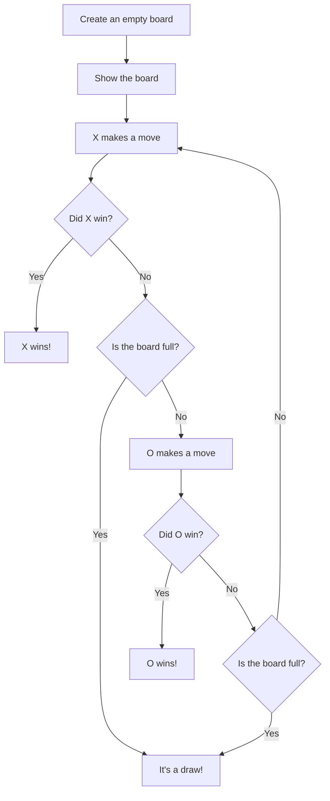

# ❌⭕ Tic Tac Toe


A two-player Tic Tac Toe game for the terminal, written in pure Python. Players take turns placing `X` and `O` on a grid, and the game automatically detects wins across rows, columns and both diagonals, as well as draws.

I built this while working through the [Futurecoder](https://futurecoder.io) Python course. It focuses on breaking a problem into small, reusable functions.

---

## 📋 Table of Contents

- [Features](#-features)
- [Demo](#-demo)
- [Getting Started](#-getting-started)
- [How to Play](#%EF%B8%8F-how-to-play)
- [How It Works](#%EF%B8%8F-how-it-works)
- [Project Structure](#-project-structure)
- [What I Learned](#-what-i-learned)
- [Roadmap](#%EF%B8%8F-roadmap)
- [Author](#-author)

---

## ✨ Features

- **Two-player local game**: `X` and `O` take turns on the same keyboard
- **Formatted board**: a clean grid with numbered rows and columns, redrawn after every move
- **Full win detection**: checks every row, every column and both diagonals
- **Draw detection**: ends the game when the board is full and nobody has won
- **Any board size**: the win-checking and display logic work for any square board, not just 3×3
- **Small, single-purpose functions**: each function does one job, which makes the code easy to read and test

---

## 🎮 Demo

Example game where `X` wins along the top row (each move is entered as a row number, then a column number):

```
  1 2 3
1  | | 
  -+-+-
2  | | 
  -+-+-
3  | | 
X to play:
1
1
  1 2 3
1 X| | 
  -+-+-
2  | | 
  -+-+-
3  | | 
O to play:
2
2
...
X to play:
1
3
  1 2 3
1 X|X|X
  -+-+-
2  |O| 
  -+-+-
3  | |O
X wins!
```

---

## 🚀 Getting Started

### Prerequisites

- [Python 3](https://www.python.org/downloads/)
- No external libraries needed

### Installation

```bash
git clone https://github.com/varshansasikumar73/tictactoe.git
cd tictactoe
python3 main.py
```

---

## 🕹️ How to Play

1. The empty board is shown with rows and columns numbered **1 to 3**.
2. `X` goes first. Type the **row number**, press **Enter**, then type the **column number** and press **Enter**.
3. The updated board is shown, and it's `O`'s turn.
4. The first player to get **three in a row** (across, down or diagonally) wins.
5. If the board fills up with no winner, it's a draw.

---

## ⚙️ How It Works

### Game flow



### How the board is stored

The board is a **list of lists**: one list per row, with `' '` for an empty square.

```python
[['X', 'X', 'X'],
 [' ', 'O', ' '],
 [' ', ' ', 'O']]
```

### How win detection works

All the win checks rely on one small function, `winning_line()`. It turns a line of squares into a **set**. Sets remove duplicates, so a set with exactly one item that isn't `' '` means every square in the line belongs to the same player.

| Function | What it does |
|---|---|
| `winning_line(strings)` | Returns `True` if every square in a line is the same player's symbol |
| `row_winner(board)` | Uses `any()` to check whether any row is a winning line |
| `column_winner(board)` | Uses `zip(*board)` to swap rows and columns, then reuses `row_winner()` |
| `main_diagonal_winner(board)` | Uses `enumerate()` to take square `[0][0]`, `[1][1]`, `[2][2]`, … |
| `diagonal_winner(board)` | Checks the main diagonal, then uses `reversed(board)` to flip the board and check the other diagonal |
| `winner(board)` | Combines all of the above: a row **or** a column **or** a diagonal |

Each check is built from the one before it, so no check needs its own code for "is this line a win?". It's all handled by `winning_line()`.

### Other functions

| Function | What it does |
|---|---|
| `make_board(size)` | Builds an empty `size × size` board using a list comprehension |
| `format_board(board)` | Turns the board into a printable grid with numbered rows and columns |
| `play_move(board, player)` | Asks for a row and column, places the player's symbol and redraws the board |
| `play_game(board_size, player1, player2)` | The main game loop. It alternates turns until someone wins or the board is full |

---

## 📁 Project Structure

```
tictactoe/
├── main.py      # All game logic: board, win detection, game loop
└── README.md    # Project documentation
```

---

## 🧠 What I Learned

- **Decomposition**: splitting a bigger problem into small functions that each do one thing
- **Reusing functions**: solving columns and diagonals by transforming the board and reusing the row check
- **Nested lists**: representing a 2D grid as a list of lists
- **Built-in functions**: `any()`, `all()`, `zip()`, `enumerate()`, `reversed()` and `set()`
- **List comprehensions and generator expressions**: building boards and rows in a single line
- **String formatting**: f-strings and `.join()` to draw the grid
- **Game loops**: alternating turns and checking for an end state after every move

---

## 🗺️ Roadmap

Ideas for future versions:

- [ ] Input validation, so letters, out-of-range numbers and already-taken squares are rejected
- [ ] "Play again?" option and a running score
- [ ] Single-player mode against a computer opponent
- [ ] Let players choose the board size when the game starts

---

## 👤 Author

**[@varshansasikumar73](https://github.com/varshansasikumar73)**

If you have feedback or suggestions, feel free to open an issue!
